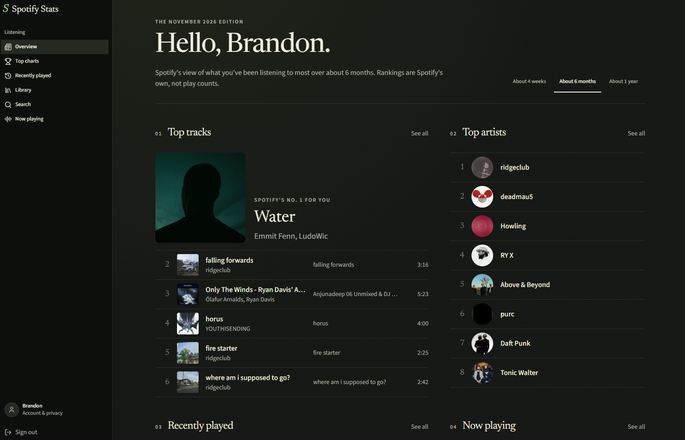

<div align="center">

# spotify-stats

**A self-hosted listening journal for your Spotify account.**

Top tracks and artists, recent plays, your library, playlists, and detailed pages for every track, album and artist, all in one container. Sign in with Spotify; nothing is stored on the server.

[](https://github.com/brandonfranke/spotify-stats/actions/workflows/docker.yml)
[](https://github.com/brandonfranke/spotify-stats/pkgs/container/spotify-stats)


<br>



</div>

---

## Contents

- [Features](#features)
- [Quick start](#quick-start)
- [Docker Compose](#docker-compose)
- [Configuration](#configuration)
- [Image tags](#image-tags)
- [Running behind a reverse proxy](#running-behind-a-reverse-proxy)
- [Updating](#updating)
- [What Spotify does and doesn't provide](#what-spotify-does-and-doesnt-provide)
- [Security and privacy](#security-and-privacy)
- [Troubleshooting](#troubleshooting)
- [Building from source](#building-from-source)

## Features

- **Overview** of your top tracks and artists, recent plays and library totals.
- **Top tracks and artists** for the last ~4 weeks, ~6 months or ~1 year.
- **Recent plays** with timestamps.
- **Library**: saved tracks, saved albums, followed artists and playlists.
- **Search** across tracks, artists and albums.
- **Detail pages** for every track, album, artist and playlist, including tempo, key and audio traits for tracks (see [Sound data](#sound-data)).
- **Now Playing** with the current queue and play, pause and skip (controls need Spotify Premium).
- **Spotify is the only login.** There are no accounts, passwords, database or volumes to manage.

## Quick start

### 1. Create a Spotify app

The container uses **your own** Spotify app, so it doesn't depend on anyone else's credentials.

1. Open the [Spotify Developer Dashboard](https://developer.spotify.com/dashboard) and choose **Create app**.
2. Select **Web API**.
3. Add a **Redirect URI** of `<APP_URL>/auth/callback`, for example:

   ```
   http://127.0.0.1:3000/auth/callback
   ```

4. Copy the app's **Client ID**. No client secret is needed.

> [!IMPORTANT]
> Spotify only accepts HTTPS redirect URIs, except loopback addresses like `http://127.0.0.1`. **`localhost` is not accepted**, so open the app at `http://127.0.0.1:3000`, not `http://localhost:3000`.

> [!NOTE]
> New Spotify apps run in *development mode*: up to five allowlisted users, and the app owner needs Spotify Premium. To let someone else sign in, add their Spotify account under **User Management** in the dashboard.

### 2. Run the container

```bash
docker run -d \
  --name spotify-stats \
  --restart unless-stopped \
  -p 3000:3000 \
  -e APP_URL=http://127.0.0.1:3000 \
  -e SPOTIFY_CLIENT_ID=your-client-id \
  ghcr.io/brandonfranke/spotify-stats:latest
```

Open **http://127.0.0.1:3000** and choose **Continue with Spotify**.

## Docker Compose

```yaml
services:
  spotify-stats:
    image: ghcr.io/brandonfranke/spotify-stats:latest
    container_name: spotify-stats
    restart: unless-stopped
    ports:
      - "3000:3000"
    environment:
      APP_URL: http://127.0.0.1:3000
      SPOTIFY_CLIENT_ID: your-client-id
      # SOUND_LOOKUPS: "false"   # only contact Spotify (see Configuration)
```

```bash
docker compose up -d
```

### Using an `.env` file

To keep settings out of `compose.yaml`, put them in a `.env` file next to it:

```dotenv
APP_URL=http://127.0.0.1:3000
SPOTIFY_CLIENT_ID=your-client-id
SOUND_LOOKUPS=true
```

Then load it with `env_file`:

```yaml
services:
  spotify-stats:
    image: ghcr.io/brandonfranke/spotify-stats:latest
    restart: unless-stopped
    ports:
      - "3000:3000"
    env_file: .env
```

The same file works with `docker run --env-file .env ...`.

## Configuration

All configuration is done with environment variables. They are checked when the container starts; a missing or invalid value stops it with an error that names the variable.

| Variable | Required | Default | Description |
| --- | :---: | --- | --- |
| `APP_URL` | ✅ | — | The URL you open the app at, with no trailing slash. Your Spotify app's redirect URI must be exactly `APP_URL/auth/callback`. |
| `SPOTIFY_CLIENT_ID` | ✅ | — | Client ID of your Spotify app. |
| `SOUND_LOOKUPS` | | `true` | Look up tempo, key and audio traits for track pages from ReccoBeats and Deezer. Set to `false` so the server only contacts Spotify. |
| `PORT` | | `3000` | Port the server listens on inside the container. |
| `HOST` | | `0.0.0.0` | Address the server listens on inside the container. |

> [!TIP]
> To use another port, change only the host side of the mapping and `APP_URL`, for example `-p 8080:3000` with `APP_URL=http://127.0.0.1:8080`. Register the new redirect URI in your Spotify app too.

### Container details

| | |
| --- | --- |
| Port | `3000/tcp` |
| Volumes | None. There is no state to persist. |
| User | Runs as the non-root `node` user. |
| Health check | Built in; calls `GET /api/health`. |
| Architecture | `linux/amd64` |

## Image tags

Images are published to the GitHub Container Registry.

| Tag | Description |
| --- | --- |
| `latest` | Latest build of the default branch. |
| `1.2.3`, `1.2` | Releases, from Git tags such as `v1.2.3`. |
| `sha-<commit>` | A specific commit. |

Pin a release tag in production if you want to choose when you upgrade.

## Running behind a reverse proxy

For anything beyond your own machine, put the container behind an HTTPS reverse proxy and set `APP_URL` to the public URL. For example, with [Caddy](https://caddyserver.com/), which obtains certificates automatically:

```yaml
services:
  spotify-stats:
    image: ghcr.io/brandonfranke/spotify-stats:latest
    restart: unless-stopped
    environment:
      APP_URL: https://music.example.com
      SPOTIFY_CLIENT_ID: your-client-id

  caddy:
    image: caddy:2
    restart: unless-stopped
    ports:
      - "80:80"
      - "443:443"
    command: caddy reverse-proxy --from music.example.com --to spotify-stats:3000
    volumes:
      - caddy_data:/data

volumes:
  caddy_data:
```

Register `https://music.example.com/auth/callback` in your Spotify app. When `APP_URL` uses HTTPS, the session cookie is marked `Secure`.

## Updating

```bash
docker compose pull && docker compose up -d
```

Or, with plain Docker, pull the new image, then remove and recreate the container:

```bash
docker pull ghcr.io/brandonfranke/spotify-stats:latest
docker rm -f spotify-stats
# re-run the docker run command from Quick start
```

Sessions live in browser cookies, so updating doesn't sign anyone out.

## What Spotify does and doesn't provide

The app shows what Spotify's Web API supplies. Some of it is limited:

- **Top lists** cover approximate windows (about 4 weeks, 6 months or 1 year). They are Spotify's own rankings, not play counts.
- **Recent plays** include only the last 50 tracks. Spotify doesn't provide a full listening history.
- **Genres belong to artists**, not tracks, and are labeled that way.
- **Other people's playlists** may show metadata only.

### Sound data

Spotify removed its audio features endpoints (tempo, key, danceability and so on) for new apps in November 2024. Track pages instead look these up on [ReccoBeats](https://reccobeats.com/) by Spotify ID, with [Deezer](https://www.deezer.com/)'s BPM (by ISRC) as a fallback. Values are estimates, some tracks have none, and time signature isn't available.

Set `SOUND_LOOKUPS=false` to turn this off. The server then contacts only Spotify.

## Security and privacy

- **No data is stored on the server.** Pages are fetched live from Spotify, and there is no database or listening history.
- **One cookie per browser.** After sign-in, the Spotify token and basic profile are kept in a single HttpOnly cookie for 30 days. Tokens are refreshed on the server shortly before they expire.
- **No client secret.** Sign-in uses Spotify's [PKCE flow](https://developer.spotify.com/documentation/web-api/tutorials/code-pkce-flow) through the official [`@spotify/web-api-ts-sdk`](https://github.com/spotify/spotify-web-api-ts-sdk).
- **Read-only access to your library.** The app asks only for read scopes, plus playback control for the Now Playing page. It never changes your library or playlists.
- **Every private page and API call is checked** on the server. State-changing requests must come from the app's own origin.
- **Signing out** deletes the cookie. To remove the app's access completely, go to [spotify.com/account/apps](https://www.spotify.com/account/apps/).

## Troubleshooting

| Problem | Fix |
| --- | --- |
| Spotify shows *INVALID_CLIENT: Invalid redirect URI* | The redirect URI in your Spotify app must be exactly `APP_URL/auth/callback`, including scheme and host. |
| Sign-in fails the first time, then works | You opened the app at an address other than `APP_URL` (for example `localhost` instead of `127.0.0.1`). Use the `APP_URL` address. |
| *This account isn't allowed to use this app yet* | Add the Spotify account under **User Management** in the Spotify Developer Dashboard. |
| The container exits immediately | Check `docker logs spotify-stats`. A required variable is missing or invalid. |
| Track pages show no tempo or key | ReccoBeats and Deezer have no data for that track, or `SOUND_LOOKUPS` is `false`. |

## Building from source

```bash
git clone https://github.com/brandonfranke/spotify-stats.git
cd spotify-stats
cp .env.example .env    # then set SPOTIFY_CLIENT_ID
docker compose up -d --build
```

The repository's `compose.yaml` builds the image locally and reads `.env`. To build without Compose:

```bash
docker build -t spotify-stats .
docker run -d -p 3000:3000 --env-file .env spotify-stats
```

### Development

The app is a [Bun](https://bun.sh/) monorepo built with TanStack Start, oRPC and shadcn/ui.

```bash
bun install
# Create apps/web/.env with SPOTIFY_CLIENT_ID and
# register http://127.0.0.1:3001/auth/callback in your Spotify app.
bun run dev    # http://127.0.0.1:3001
```

| Script | Purpose |
| --- | --- |
| `bun run dev` | Start the dev server |
| `bun run build` | Production build (`apps/web/.output`) |
| `bun run test` | Unit tests (Vitest) |
| `bun run check-types` | TypeScript checks |

```
apps/web/       TanStack Start app: routes, components, sign-in
packages/api/   oRPC routers calling the official Spotify SDK
packages/ui/    Shared shadcn/ui (Base UI) components and design tokens
```

---

<sub>Not affiliated with or endorsed by Spotify. Spotify is a trademark of Spotify AB. Content and artwork are provided by Spotify.</sub>
